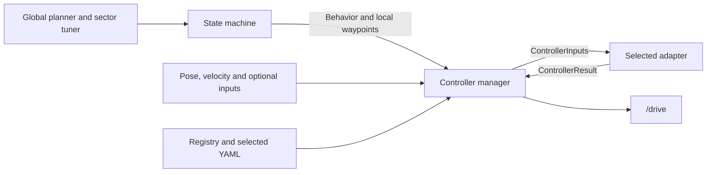

# Controller stack

ROS 2 Humble controller package for MAP, AGMPC, NMPC, Pure Pursuit (PP), and Follow the Gap (FTG).

The state machine chooses **driving behavior and local waypoints**. The controller registry chooses **the algorithm**. The manager runs the selected adapter and publishes speed and steering commands.

## Package layout

```text
controller/
├── core/
│   ├── controller_manager.py     # ROS inputs, control loop, commands and evaluation services
│   ├── controller_interface.py   # Shared inputs, results and adapter contract
│   ├── controller_registry.py    # Controller factories, configuration and capabilities
│   └── reference.py              # Shared predictive reference and tracking mechanics
├── controller/
│   ├── map/                     # MAP adapter and algorithm
│   ├── pp/                      # Pure Pursuit adapter and algorithm
│   ├── ftg/                     # LiDAR controller adapter and algorithm
│   ├── agmpc/                     # AGMPC adapter, QP solver and tuning YAML
│   ├── nmpc/                    # NMPC adapter, nonlinear solver, model and tuning YAML
│   └── pursuit.py               # Shared MAP/PP adapter and L1 parameter handling
├── evaluation/
│   ├── tuning_params.yaml       # Map, controller, tuning-file selection and trial settings
│   ├── trial_runner.py          # Continuous two-lap simulation and recording
│   ├── metrics.py
│   ├── plotting.py
│   └── visualization/           # One unique directory per experiment
├── launch/
├── test/
└── depricated_documentation/    # Historical documentation
```

Paths in this tree are relative to this ROS package. Paths in the experiment YAML are relative to the **repository root**.

The previous README is preserved in [the documentation archive](depricated_documentation/README.md).

## Architecture



| Component | Responsibility |
|---|---|
| [Manager](core/controller_manager.py) | Receive ROS data, run the selected adapter at 40 Hz, validate results, publish commands and handle enable/reset. |
| [Interface](core/controller_interface.py) | Define `ControllerInputs`, `ControllerResult`, `ControllerContext`, and `ControllerAdapter`. |
| [Registry](core/controller_registry.py) | Define factories, configuration loaders, default paths, required inputs, supported behaviors and report capabilities. |
| [Reference utilities](core/reference.py) | Share nearest-waypoint selection, time sampling, optional latency compensation and predictive command integration. |
| Controller adapter | Connect one algorithm to the common interface and expose its diagnostics and optional parameter updates. |
| [Evaluation](evaluation/README.md) | Run two continuous laps, record data and generate controller-independent reports. |

The state machine is organized in [state_machine.py](../state_machine/state_machine/state_machine.py) for ROS/parameter handling and [behavior.py](../state_machine/state_machine/behavior.py) for behavior logic.

Its behaviors are `GB_TRACK`, `TRAILING`, `OVERTAKE`, and `FTGONLY`. Time trials use `GB_TRACK` for every controller. Controller algorithms do not have separate state-machine states.

## Available controllers

| Selection | Method | Normal-stack SIM preset |
|---|---|---|
| `MAP` | Pursuit control using a steering lookup table | [SIM L1 parameters](../stack_master/config/SIM/l1_params.yaml) |
| `PP` | Pure Pursuit | [SIM L1 parameters](../stack_master/config/SIM/l1_params.yaml) |
| `AGMPC` | Geometric Ackermann MPC using a CasADi conic QP solver | [AGMPC parameters](controller/agmpc/agmpc_params.yaml) |
| `NMPC` | Nonlinear bicycle MPC using CasADi/IPOPT | [NMPC parameters](controller/nmpc/nmpc_params.yaml) |
| `FTG` | Reactive LiDAR gap following | [State-machine parameters](../stack_master/config/state_machine_params.yaml) |

Use `AGMPC` for the geometric controller. Its implementation and tuning file are under `controller/agmpc/`.

AGMPC and NMPC support global tracking only. MAP and PP support global tracking, trailing and overtaking; their registry entries explicitly route `FTGONLY` to FTG. FTG accepts the four behavior states and runs its reactive LiDAR algorithm. Unsupported controller/behavior combinations produce a zero command.

AGMPC and NMPC have independent implementations and configurations. Both use the shared predictive tracking mechanics; NMPC does not inherit from the AGMPC controller class. See the [AGMPC guide](controller/agmpc/README.md) and [NMPC guide](controller/nmpc/README.md) for their models and parameters.

## Run a controller-tuning trial

Run the following commands inside the **existing ROS 2 container**. Stop other simulator/controller launches first.

After adding or restructuring Python packages, build the affected ROS packages:

```bash
cd ~/ws
colcon build --symlink-install --packages-select controller state_machine stack_master
source install/setup.bash
```

Edit **only [evaluation/tuning_params.yaml](evaluation/tuning_params.yaml)** for a tuning trial.
It contains the map, selected controller, trial settings, and every controller's
parameters. Set the selection at the top:

```yaml
controller: AGMPC
```

Then tune the corresponding block in that same file:

```yaml
controllers:
  MAP:
    lookup_table: NUC2_hangar_pacejka
    # MAP parameters...
  AGMPC:
    # AGMPC horizon, weights, limits and timing parameters...
  NMPC:
    # NMPC horizon, weights, limits and timing parameters...
  PP:
    # Pure Pursuit parameters...
  FTG:
    # LiDAR controller parameters...
```

This illustrates the layout; the actual YAML already contains all parameter
values copied from the existing presets. Only the selected block is loaded.
For example, editing `controllers.AGMPC.speed_max` changes the tuning trial's
AGMPC speed limit. There is no `controller_config` path to change for evaluation.

The separate controller preset files in the table above apply to normal stack
launches. Tuning trials use the values in the evaluation YAML and do not write
them back into those presets.

Launch the evaluation:

```bash
ros2 launch stack_master controller_tuning.launch.py
```

This launches its own headless simulator, resets the vehicle and controller once, runs **two continuous laps without resetting between them**, then stops and saves the reports. It does not require RViz.

The experiment YAML also contains startup, reset, trial, stall, data and stopping timeouts. Changing experiment or controller YAML requires a fresh launch, **not a Docker image rebuild or ROS rebuild**.

For a different checkout or experiment YAML:

```bash
ros2 launch stack_master controller_tuning.launch.py \
  source_root:=/absolute/path/to/race_stack \
  evaluation_config:=/absolute/path/to/experiment.yaml
```

## Results

Each trial creates a unique directory under `controller/evaluation/visualization/` in the source checkout.

| File | Contents |
|---|---|
| `experiment.yaml` | Exact complete single-file experiment configuration, including all controller blocks. |
| `controller_params.yaml` | Resolved parameters for the selected controller. |
| `planned_path.csv` | Scaled global planner waypoints. |
| `samples.csv` | Per-command pose, references, commands, validity, diagnostics and lap assignment. |
| `summary.json` | Completion reason, stop confirmation, lap times, errors, sample gaps and available solver/constraint metrics. |
| `planned_path.png` | Planned path colored by desired waypoint speed, with a colorbar. |
| `trajectory_comparison.png` | Three panels: both laps, lap one, lap two, each overlaid on the planned path. |
| `tracking_and_commands.png` | Position error, heading error, speed comparison and steering comparison. |

Heading errors are reported in **degrees**. Pose headings and steering angles remain in **radians**; speeds are in **m/s**.

The desired speeds shown in reports already include sector-tuner scaling. For MAP/PP, the recorded reference is the nearest planner waypoint before the controller runs. The steering reference is planner-derived, `atan(wheelbase * curvature)`. For AGMPC/NMPC, the reference is the first point of the time-sampled controller horizon.

Measured speed is recorded separately from the published speed command. Steering feedback for the predictive controllers is the accumulated steering command, not a measured steering angle. Position error is distance to the recorded reference waypoint, not perpendicular distance to a path segment.

Unavailable metrics are left unavailable: MAP/PP/FTG do not acquire fabricated solver timings, and the current simulator bridge does not publish collision counts. FTG has no waypoint-tracking reference. A stalled or interrupted trial saves an incomplete report.

Regenerate figures from an existing recording without driving again:

```bash
ros2 run controller controller_evaluation_plot /absolute/path/to/experiment
```

See [evaluation/README.md](evaluation/README.md) for metric definitions and report behavior.

## Run against an already running simulator

The time-trial launch starts the controller and state machine; it expects the simulator/base system to be running separately:

```bash
source ~/ws/install/setup.bash
ros2 launch stack_master time_trials_launch.xml racecar_version:=SIM ctrl_algo:=AGMPC
```

Use `ctrl_algo:=MAP`, `NMPC`, `PP`, or `FTG` to select another registry entry. A generic `controller_config:=/absolute/path/to/params.yaml` overrides the default file. The controller-specific `agmpc_config`, `nmpc_config`, and `map_config` arguments are also available.

## Shared inputs and outputs

The manager subscribes to these existing stack interfaces. Each registry entry declares which inputs its adapter requires.

| Topic | Type | Purpose |
|---|---|---|
| `/state` | `std_msgs/String` | Driving behavior. |
| `/local_waypoints` | `f110_msgs/WpntArray` | Local planner window. |
| `/global_waypoints` | `f110_msgs/WpntArray` | Track length and global geometry. |
| `/car_state/pose` | `geometry_msgs/PoseStamped` | Map pose. |
| `/car_state/odom` | `nav_msgs/Odometry` | Measured speed. |
| `/car_state/frenet/odom` | `nav_msgs/Odometry` | Frenet state when needed. |
| `/perception/obstacles` | `f110_msgs/ObstacleArray` | Obstacles and opponent selection. |
| `/vesc/sensors/imu/raw` | `sensor_msgs/Imu` | Acceleration input when available. |
| `/scan` | `sensor_msgs/LaserScan` | LiDAR input for FTG. |

Commands are published on **`/drive`** as `ackermann_msgs/AckermannDriveStamped`: `drive.speed` in m/s and `drive.steering_angle` in radians. Optional lookahead and steering diagnostics are published by the manager.

In evaluation mode, the manager also publishes JSON samples on `/controller/evaluation/sample` and provides `/controller/evaluation/enable` (`std_srvs/SetBool`) and `/controller/evaluation/reset` (`std_srvs/Trigger`). Reset is accepted only while paused.

## Add a controller

1. Create `controller/<name>/` inside this ROS package, including `__init__.py`, an adapter, its algorithm and an optional tuning YAML.
2. Implement [ControllerAdapter](core/controller_interface.py):
   - Set `config` and expose configuration errors through `error`.
   - Implement `reset(steering=0.)` and `step(ControllerInputs) -> ControllerResult`.
   - Return speed, steering angle, validity, a failure reason and any available diagnostics.
   - Supply parameter descriptors/updates or cleanup through the optional hooks when needed.
3. Add a `ControllerSpec` entry in [core/controller_registry.py](core/controller_registry.py), defining its factory, configuration loader, default configuration path, supported behaviors and required inputs.
4. Add focused tests under `test/`, rebuild `controller`, and add its parameter block under `controllers.<NAME>` in the evaluation YAML.

The shared input object includes pose, speed, local waypoints, behavior, control timestep and pose age, plus optional Frenet state, acceleration, obstacles/opponent, track length and scan. Waypoint array columns remain `x, y, speed, track ratio, s, curvature, heading, acceleration`.

Optional registry report capabilities `solve_time` and `constraints` enable the corresponding metrics. Reference descriptions and plot labels also come from the registry. This keeps algorithm-specific branches out of the manager and evaluator.

Package discovery installs new controller packages and adjacent YAML files automatically. A controller that fits the existing input/result contract normally needs **no changes to the state machine, manager, or evaluator**.
